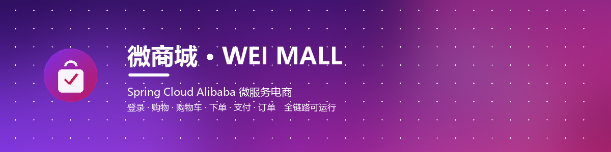
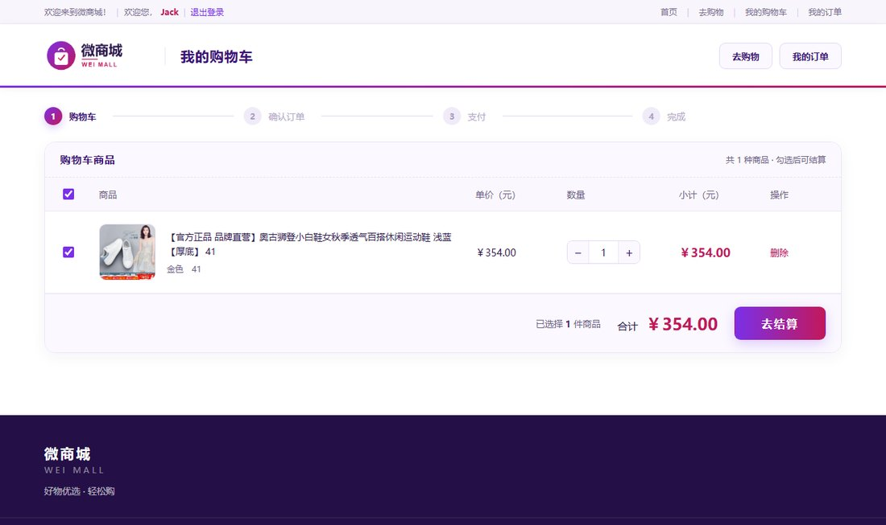
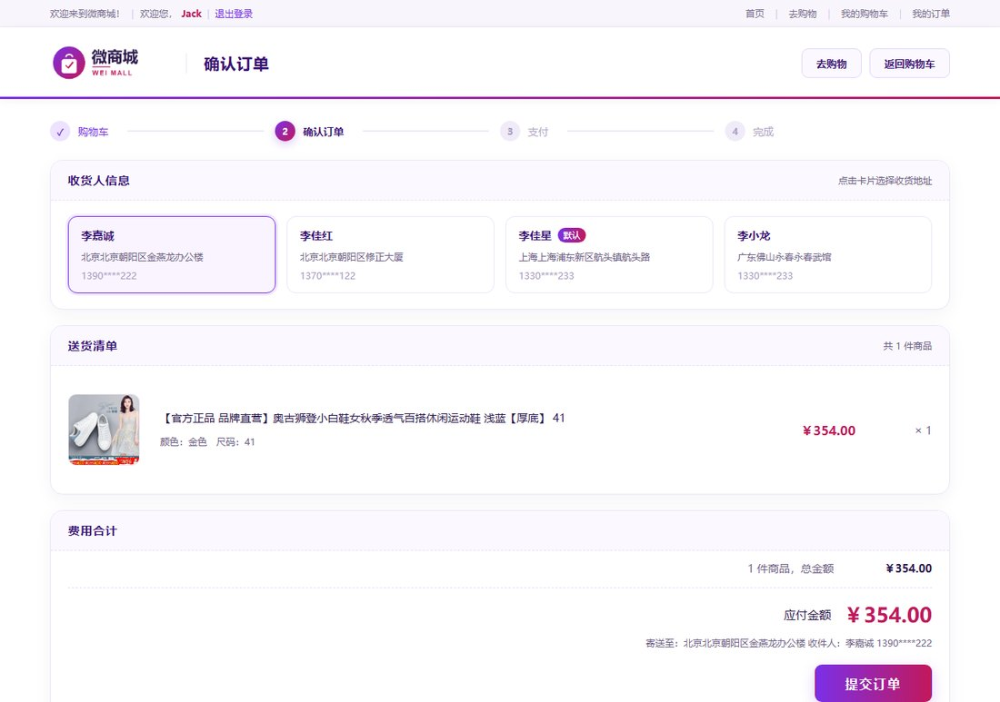
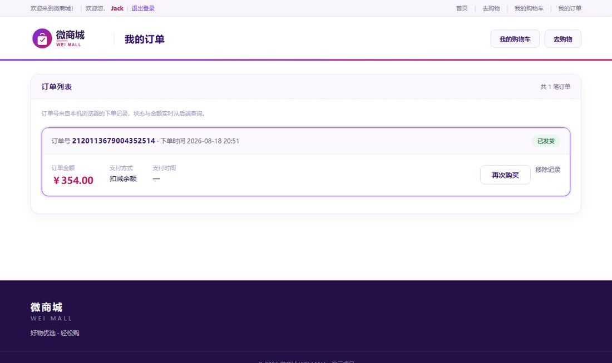
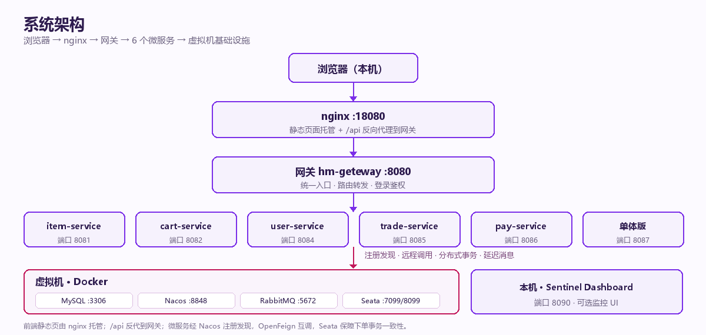

<p align="center">
  
</p>

<h1 align="center">微商城 · WEI MALL</h1>

<p align="center">
  基于 Spring Cloud Alibaba 的微服务电商系统<br>
  购物支付全链路 · 微服务治理 · 配置与部署脚本完整可复现
</p>

<p align="center">
  
  
  
  
  
  
</p>

> 一套基于 Spring Cloud Alibaba 的微服务电商系统：前端为紫 → 玫红视觉体系的静态站，后端 9 个 Maven 模块覆盖注册发现、远程调用、分布式事务与延迟消息；虚拟机侧的配置、建库 SQL 与 Nacos 配置全部以文本形式随仓库交付，clone 后按 7 步即可复现整套环境。

---

## 目录

- [📸 项目展示](#-项目展示)
- [✨ 功能清单](#-功能清单)
- [🏗 系统架构](#-系统架构)
- [🔄 核心业务链路](#-核心业务链路)
- [🛠 技术栈](#-技术栈)
- [📁 目录结构](#-目录结构)
- [🚀 快速开始（部署）](#-快速开始部署)
- [🔌 端口一览](#-端口一览)
- [📦 虚拟机那部分怎么进仓库的](#-虚拟机那部分怎么进仓库的)
- [❓ 常见问题](#-常见问题)
- [📄 补充说明](#-补充说明)

---

## 📸 项目展示

> 全部为本机真实运行截图，非设计稿。`docs/images/` 下按浏览顺序命名，替换同名文件即可更新，README 无需改动。

<table>
  <tr>
    <td align="center"><br>
      <b>登录页</b><br>紫玫红渐变主视觉 · 账户登录</td>
    <td align="center"><br>
      <b>首页</b><br>品牌介绍落地页 · 去购物入口</td>
  </tr>
  <tr>
    <td align="center"><br>
      <b>商品页</b><br>关键词搜索 · 三行固定筛选 · 排序分页</td>
    <td align="center"><br>
      <b>购物车</b><br>勾选结算 · 数量与合计 · 步骤条</td>
  </tr>
  <tr>
    <td align="center"><br>
      <b>确认订单</b><br>收货地址 · 送货清单 · 应付金额</td>
    <td align="center"><br>
      <b>我的订单</b><br>实时查后端状态 · 去支付 / 再次购买</td>
  </tr>
</table>

<details>
<summary><b>展开查看更多：收银台 · 支付成功</b></summary>

<br>

<table>
  <tr>
    <td align="center"><br>
      <b>收银台</b><br>余额支付 · 倒计时 · 确认支付</td>
    <td align="center"><br>
      <b>支付成功</b><br>金额与订单号 · 预计送达 · 查看订单</td>
  </tr>
</table>

</details>

---

## ✨ 功能清单

<details open>
<summary><b>用户端</b></summary>

| 模块 | 能力 |
| --- | --- |
| 登录 | 账户登录、记住我、全站登录态（用户名 + 退出登录） |
| 首页 | 品牌介绍、三步购物流程、能力卡片、去购物 |
| 商品 | 关键词搜索 / 回车、分类 / 品牌 / 价格三行筛选（点击不再塌陷）、排序、分页、商品卡片 |
| 购物车 | 勾选、数量增减、实时合计、去结算、空状态 |
| 下单 | 「立刻购买」直达结算、收货地址选择、送货清单、金额校验、`@GlobalTransactional` 提交 |
| 支付 | 余额支付、倒计时、支付成功后跳结果页 |
| 订单 | 我的订单列表、状态徽章、去支付 / 再次购买、移除本地记录 |

</details>

<details>
<summary><b>界面与体验</b></summary>

- 全站统一的紫玫红视觉体系，含自绘 logo、背景图与 Banner
- 导航只保留可用入口：登录、去购物、我的购物车、我的订单、退出登录
- 商品筛选固定三行，点击只做高亮与取消，布局不跳动
- 登录态由 `auth.js` 统一管理，静态页与 Vue 页表现一致
- 下单链路数据完整贯通：立刻购买 → 确认订单 → 余额支付 → 订单查询

</details>

<details>
<summary><b>微服务能力（真实用到，非摆设）</b></summary>

| 组件 | 部署 | 在项目中做什么 |
| --- | --- | --- |
| Nacos | 虚拟机 Docker :8848 | 服务注册发现 + 6 个共享配置（数据源、Seata、日志、网关路由） |
| OpenFeign | 内嵌 SDK | 下单时 `trade-service` 调 `item-service` 扣库存、调 `user-service` 扣余额，读操作可降级、写操作必失败 |
| Seata | 虚拟机 TC :7099 / :8099 | `OrderServiceImpl` 上 `@GlobalTransactional` 保证跨服务下单事务一致 |
| RabbitMQ | 虚拟机 :5672 | 下单发延迟消息，超时未支付自动取消；支付成功后发消息通知交易服务 |
| Sentinel | 客户端 SDK + 可选 Dashboard :8090 | 购物车 / 商品接口限流，Dashboard 只是监控 UI，不启动也生效 |

</details>

---

## 🏗 系统架构



| 层 | 组成 | 说明 |
| --- | --- | --- |
| 客户端层 | 浏览器 | 纯静态页面，Vue 2 + axios |
| 接入层 | nginx :18080 | 托管 `html/hmall-portal/`，`/api` 反代到网关 8080 |
| 网关层 | hm-geteway :8080 | 路由转发、登录鉴权、用户信息传递 |
| 服务层 | 6 个微服务 + 单体版（可选） | item / cart / user / trade / pay + hm-service |
| 基础设施 | 虚拟机 Docker | MySQL 分库、Nacos、RabbitMQ（延迟插件）、Seata TC |

---

## 🔄 核心业务链路

**登录 → 去购物 → 筛选商品 → 加入购物车 / 立刻购买 → 确认订单 → 余额支付 → 支付成功 → 我的订单**

| 步骤 | 页面 | 后端动作 | 涉及组件 |
| --- | --- | --- | --- |
| 1 | `search.html` | `GET /search/list` 检索商品 | ES 检索服务 / item-service |
| 2 | `cart.html` | `GET/POST /carts` | cart-service |
| 3 | `order-confirm.html` | `GET /addresses`、`POST /orders` | trade-service、OpenFeign、**Seata**、**RabbitMQ 延迟消息** |
| 4 | `pay.html` | `POST /pay-orders`、余额扣减 | pay-service、user-service |
| 5 | `paysuccess.html` / `myOrder.html` | `GET /orders/{id}` 查真实状态 | trade-service |

> 下单时 `@GlobalTransactional` 开启全局事务；同时发送一条延迟消息，超时未支付由消费端关闭订单。支付成功后通过 MQ 通知交易服务标记订单已支付，实现服务解耦。

---

## 🛠 技术栈

| 分类 | 技术 |
| --- | --- |
| 后端 | Spring Boot、Spring Cloud Alibaba、Maven 多模块（9 模块）、MyBatis-Plus |
| 治理 | Nacos（注册 / 配置）、OpenFeign、Sentinel、Seata AT 模式 |
| 消息 | RabbitMQ + `rabbitmq_delayed_message_exchange` 延迟插件 |
| 存储 | MySQL 8 分库（hm-item / hm-cart / hm-user / hm-trade / hm-pay） |
| 前端 | Vue 2、axios、原生 HTML/CSS、nginx 静态托管 |
| 运维 | VMware CentOS 7 + Docker、Sentinel Dashboard（可选） |

---

## 📁 目录结构

```
wei-mall-clean/
├── README.md                       # 本文件
├── backend/hmall/                  # 后端 9 个 Maven 模块
│   ├── hm-geteway/                 # 网关 8080
│   ├── item-service/ … pay-service/   # 6 个微服务
│   ├── hm-api/ hm-common/          # Feign 客户端、公共配置
│   └── hm-service/                 # 单体版 8087（可选）
├── frontend/hmall-nginx/
│   ├── conf/nginx.conf             # 18080 / 18081 / 18082 / 18083
│   └── html/hmall-portal/          # 页面、样式、脚本、图片
├── deploy/                         # ★ 虚拟机那部分的「可上传形态」
│   ├── mysql/conf/hm.cnf           # MySQL 挂载配置
│   ├── mysql/init/hmall.sql        # 首次启动自动执行的单体版建库脚本
│   ├── nacos/custom.env            # Nacos 环境文件
│   ├── nacos/config/               # ★ 从 VM 导出的 6 个 Nacos 业务配置
│   ├── seata/                      # Seata TC 服务端配置
│   ├── rabbitmq/*.ez               # 延迟交换机插件
│   └── sql/                        # 7 个建库脚本（分库 + nacos + seata-tc）
├── docs/
│   ├── images/                     # README 展示图（Banner / 架构图 / 8 张运行截图）
│   └── 部署与启动说明.md            # 更细的容器、SQL、Nacos 导入步骤
└── tests/                          # JMeter 压测脚本
```

---

## 🚀 快速开始（部署）

### 环境要求

| 依赖 | 说明 |
| --- | --- |
| 虚拟机 | CentOS 7 + Docker，与本机可互通（NAT / VMnet8） |
| 本机 | IDEA、JDK（Sentinel Dashboard 用 17）、nginx（用仓库内目录） |
| 数据库 | MySQL 8 容器，3306 映射到宿主机 |
| 账号 | 演示账号 `jack / 123`（示例数据，仅本地演示） |

### 这个项目分两处跑，先理解再动手

| 跑在哪 | 是什么 | 仓库里的对应 |
| --- | --- | --- |
| 虚拟机 | 4 个 Docker 容器：MySQL / Nacos / RabbitMQ / Seata TC | `deploy/` 挂载配置 + SQL + 导出的 Nacos 配置 |
| 本机 | nginx 静态站 + IDEA 里 6 个微服务（+ 可选单体版、Sentinel Dashboard） | `frontend/`、`backend/` |

**Git 仓库只保存文件，不保存运行中的容器和数据卷**；因此 `deploy/` 就是「虚拟机那部分」的源代码。

### 步骤

**1. 克隆并替换 IP**

仓库里有 17 个文件写死了开发机的虚拟机 IP `192.168.197.129`，换成你自己的 `<VM_IP>`：

```bash
git clone <你的仓库地址>
cd wei-mall-clean
grep -rl 192.168.197.129 . | xargs sed -i 's/192.168.197.129/<VM_IP>/g'
```

Windows 可在 IDEA 里用 `Edit → Find → Replace in Files`。主要位置：各服务 `bootstrap.yaml` / `application*.yaml`、`deploy/nacos/custom.env`、`deploy/nacos/config/shared-*.yaml`、`deploy/seata/application.yml`。

**2. 虚拟机起 4 个容器**

把 `deploy/` 上传到 VM，按下列要点创建容器（具体 `docker run` 参数按镜像版本与挂载路径调整）：

| 容器 | 端口 | 挂载 / 配置 | 备注 |
| --- | --- | --- | --- |
| MySQL | 3306 | `deploy/mysql/conf/hm.cnf`、`deploy/mysql/init/` | `init/*.sql` 只在首次创建数据卷时自动执行 |
| Nacos | 8848 | `deploy/nacos/custom.env` | standalone + 外挂 MySQL 库 `nacos` |
| RabbitMQ | 5672 / 15672 | `deploy/rabbitmq/*.ez` | 插件放入容器后用 `rabbitmq-plugins enable rabbitmq_delayed_message_exchange` 启用 |
| Seata TC | **7099 / 8099** | `deploy/seata/` | 控制台 7099 / 服务 8099，按此端口配置即可 |

**3. 导入 SQL（顺序不能乱）**

| 顺序 | 脚本 | 用途 |
| --- | --- | --- |
| 1 | `deploy/sql/nacos.sql`、`deploy/sql/seata-tc.sql` | Nacos、Seata 元数据库 |
| 2 | `deploy/sql/hm-item.sql` … `hm-pay.sql` | 5 个业务分库 |
| 3 | `deploy/mysql/init/hmall.sql` | 单体版数据（可选，不跑单体版可跳过） |

**4. 导入 Nacos 配置（最关键的一步）**

⚠️ `deploy/sql/nacos.sql` **只有建表语句，没有配置内容**。共享配置存放在 `nacos.config_info` 表，本仓库已导出到 `deploy/nacos/config/`。缺少这一步，所有微服务都连不上数据库、也注册不上 Nacos。

按文件名作为 dataId、分组 `DEFAULT_GROUP` 导入 6 个文件：

| dataId | 作用 |
| --- | --- |
| `shared-jdbc.yaml` | 各服务数据源（支持 `hm.db.host` / `hm.db.pw` 环境变量覆盖） |
| `shared-seata.yaml` | Seata TC 注册与事务组映射 |
| `shared-log.yaml` / `shared-swagger.yaml` | 日志级别 / 接口文档 |
| `gateway-routes.json` | 网关路由规则 |
| `cart-service.yaml` | 购物车容量限制 |

Nacos 控制台「配置管理 → 导入配置」可批量导入；也可直接写入 `nacos.config_info` 表。`_index.json` 是导出清单，不用导入。

**5. 启动前端**

用仓库里的 nginx 目录启动（Windows 需自行下载 `nginx.exe`，仓库不含二进制）：

```bash
nginx -p frontend/hmall-nginx
```

打开 `http://localhost:18080/`。

**6. IDEA 启动后端**

打开 `backend/hmall`，依次启动 6 个微服务，最后起网关；单体版 `HMallApplication`（8087）可选。详细顺序见 [docs/部署与启动说明.md](docs/部署与启动说明.md)。

**7. 可选：Sentinel Dashboard**

```bash
java -Dserver.port=8090 -jar sentinel-dashboard-1.8.6.jar
```

访问 `localhost:8090`，账号密码 `sentinel / sentinel`。jar 包未入库，从 Sentinel 官方 Release 下载即可。

### 验证清单

- [ ] Nacos 控制台服务列表出现 6 个微服务
- [ ] `http://localhost:18080/` 首页 → 去购物能看到商品列表（约 8.8 万件）
- [ ] 登录后顶栏显示用户名与退出登录
- [ ] 「立刻购买」跳结算页，商品、地址、金额都有值（不是空白）
- [ ] 购物车 → 确认订单 → 余额支付 → 支付成功 → 我的订单能看到状态

---

## 🔌 端口一览

| 服务 | 端口 |
| --- | --- |
| 网关 hm-geteway | 8080 |
| item / cart / user / trade / pay | 8081 / 8082 / 8084 / 8085 / 8086 |
| ItemApplication 2（多实例） | 8083 |
| 单体版 hm-service | 8087 |
| nginx 门户 / 后台 / 单体入口 | 18080 / 18081、18082 / 18083 |
| MySQL / Nacos | 3306 / 8848 |
| RabbitMQ / 管理台 | 5672 / 15672 |
| Seata TC 控制台 / 服务 | 7099 / 8099 |
| Sentinel Dashboard / 客户端 | 8090 / 8719 |

---

## 📦 虚拟机那部分怎么进仓库的

| 虚拟机里的东西 | 仓库里的对应 | 是否上传 |
| --- | --- | --- |
| VMware 虚拟机磁盘（vmdk，数十 GB） | — | 不传 |
| 4 个 Docker 容器（运行状态） | `deploy/` 配置 + 部署步骤 | 只传配置与脚本 |
| MySQL 数据卷（业务数据 / Nacos 配置表） | `deploy/sql/*.sql`、`deploy/mysql/init/hmall.sql` | 只传建库脚本 |
| Nacos 配置中心的 6 个配置 | `deploy/nacos/config/` | **传**（从 VM 的 `config_info` 表导出） |
| RabbitMQ 延迟插件 | `deploy/rabbitmq/*.ez` | 传 |
| Seata TC 配置 | `deploy/seata/` | 传 |
| Sentinel Dashboard jar（22 MB） | — | 不传，官网可下 |
| JMeter 软件本体（131 MB） | `tests/*.jmx` | 只传脚本 |

> `deploy/` 里的文件就是「把虚拟机环境还原成文本」的结果。别人拿到仓库，按上面 7 步即可重建，不需要你的虚拟机镜像。

---

## ❓ 常见问题

| 现象 | 处理 |
| --- | --- |
| 服务启动报连不上 Nacos / 数据库 | 99% 是没换 `192.168.197.129`，或第 4 步 Nacos 配置没导入 |
| Seata 连不上 | 确认端口为 **7099 / 8099**，且与 `deploy/seata/application.yml` 一致 |
| 下单后订单不自动取消 | RabbitMQ 延迟交换机插件未启用，检查 `rabbitmq-plugins list` |
| 支付时报「支付单创建失败」 | 该订单已支付过，去「我的订单」看状态即可 |
| 我的订单是空的 | 订单号记在浏览器 localStorage，换浏览器 / 清缓存会丢（后端未提供列表接口，前端按本地记录逐条查询） |
| Sentinel Dashboard 打不开 | 可选组件，不影响限流规则生效；JDK 17 启动 jar |
| 仓库 80 MB 太大 | 主要是两个 35 MB 商品数据 SQL（分库版 / 单体版各一份），可只保留需要的一组 |
| 端口被占用 | 检查 IDEA 是否有重复启动项；单体版已改 8087，不会和网关 8080 冲突 |

---

## 📄 补充说明

- 本项目为**学习与展示用途**的示例工程，界面、品牌素材与文档均为自主设计。
- 配置中的数据库 / Nacos 口令、演示账号均为**示例默认值**，仅适用于本地或内网演示；**请勿用于公网服务器**，对外部署请先改为环境变量或强口令。
- `deploy/nacos/config/` 是运行环境的真实快照，含内网 IP；换成自己的环境后记得同步修改。
- 商品数据与图片为公开演示数据外链，仅用于界面展示。
